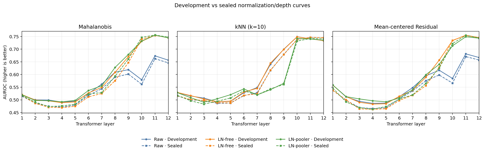

# Document OOD Gate

**Detecting unsupported inputs in a document classifier.**

A document classifier can assign a familiar label to a page outside its supported
categories. This project evaluates whether the model's confidence and internal
features can identify those unsupported, or out-of-distribution (OOD), inputs.

The Python pipeline audits **4,312 document images**, compares features across
**12 Transformer layers**, and evaluates a fixed set of methods on **3,018 held-out
images**. It uses Microsoft's pretrained, frozen [16-class DiT model](https://huggingface.co/microsoft/dit-base-finetuned-rvlcdip).
The work covers data preparation, model integration, statistical evaluation, and
representation analysis.

## Findings

- **The clearest OOD separation emerges in the middle-to-late layers.** Full layer
  curves show how detection performance changes with depth and feature readout.
- **LayerNorm substantially improves late-layer Mahalanobis and residual scores.**
  The held-out Layer 12 comparison below isolates normalization without learned
  affine parameters (LN-free).

| Layer 12 score | Raw features: AUROC ↑ | With LayerNorm: AUROC ↑ |
|---|---:|---:|
| Mahalanobis | 0.6458 | 0.7455 |
| Mean-centred PCA residual | 0.6571 | 0.7449 |

AUROC measures separation between supported and unsupported inputs, rather than
classification accuracy. These rows use a fixed 32k reference bank;
[the saved table](results/tables/07_sealed_test/sealed_layer_grid.csv) includes
all 108 layer/readout/method combinations and confidence intervals.



**Reliable rejection remains difficult.** Energy has the highest held-out AUROC
point estimate (0.7650) across the complete frozen panel. Even the configuration
with the lowest FPR95 accepts 81.71% of unsupported pages when accepting at least
95% of shifted, supported pages. The findings inform representation choice;
a reliable deployment threshold has not been established.

## Pipeline

- **Audit and split:** check document availability, review duplicate candidates,
  handle conflicting labels, and keep confirmed duplicate groups in one partition.
- **Extract and cache:** use batched PyTorch inference for the layer study, with
  resumable, disk-backed caches and automatic batch reduction after GPU memory exhaustion.
- **Compare and report:** fit OOD scores under fixed settings; export CSV/JSON
  metrics, layer plots, and 2,000-resample bootstrap confidence intervals.
- **Validate the implementation:** [regression tests](tests/) cover score semantics,
  duplicate isolation, feature equivalence, and interrupted-cache recovery.

Implemented with **Python, PyTorch, Hugging Face Transformers, NumPy, pandas,
and scikit-learn**, exposed through the `doc-ood` command-line interface.

## Explore

Print the saved core results from the repository root:

```bash
python scripts/preview_results.py
```

The preview uses only Python's standard library and committed aggregate files;
it needs no dataset, model download, or GPU.

[Results and evidence](results/README.md) ·
[Study, data, and limitations](docs/STUDY.md) ·
[Setup and CLI guide](docs/REPRODUCIBILITY.md) ·
[Source code](src/document_ood_gate/)

The model, datasets, and detection methods build on [prior work](docs/STUDY.md#references).
Raw documents, weights, and feature caches are obtained separately; see
[data access and reuse](docs/STUDY.md#data-and-provenance).
