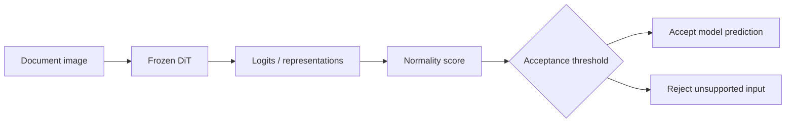

# Document OOD Gate
### Reliability evaluation for a frozen document classifier

Can a document classifier recognise when a page falls outside its supported categories?
This project evaluates post-hoc out-of-distribution (OOD) scores for a frozen,
16-class DiT model in a document-routing setting.

**Main finding:** development gains from representation-based methods did not translate
into better sealed-test AUROC than Energy. Energy reached **0.7650 AUROC**, but accepted
**83.69% of unsupported documents** at the operating point accepting at least 95% of
supported, shifted documents. The study documents why these scores are insufficient
for a reliable deployment gate.

[Study and limitations](docs/STUDY.md) ·
[Complete results](results/README.md) · [Reproducibility](docs/REPRODUCIBILITY.md) ·
[Data and attribution](docs/DATA.md)

## What this project contributes

- **Baseline reproduction:** an independent rerun on 4,312 available/recovered images,
  with the 105 unavailable source images handled separately and explicitly.
- **Data integrity:** duplicate-aware splitting, an explicit rule for contradictory
  labels, and separate reference, threshold-validation, and guardrail sets.
- **Controlled comparisons:** output scores and representation methods, followed by
  a complete 12-layer study and fixed normalization ablations.
- **Auditable evaluation:** frozen settings, five pre-specified replication predictions,
  a one-time 3,018-image sealed evaluation, and machine-readable results with bootstrap
  confidence intervals.

The contribution is the evaluation pipeline, data audit, and empirical analysis.
The DiT checkpoint and OOD methods build on [prior work](docs/REFERENCES.md).
This repository contains a completed research study; it does not include a production
document-routing service or a newly trained classifier.

## How it works



This is the intended decision flow being evaluated. The gate uses the frozen model's
outputs or features, so it still requires model inference. Correctness of the accepted
16-class prediction is a separate task.

| Documents | Meaning | Desired action |
|---|---|---|
| T | Familiar RVL-CDIP pages | Accept; used as a false-rejection guardrail |
| N | Shifted pages in supported categories | Accept |
| O | Pages outside all 16 supported categories | Reject |

## Final held-out results

Core sealed panel: **694 N + 2,324 O**, with a 32k reference bank for feature methods.
AUROC and FPR95 are proportions; arrows indicate the preferred direction.

| Method | AUROC ↑ [95% CI] | FPR95 ↓ |
|---|---:|---:|
| MSP | 0.7372 [0.7160, 0.7605] | 0.8468 |
| **Energy** | **0.7650 [0.7452, 0.7862]** | **0.8369** |
| Mahalanobis | 0.7474 [0.7253, 0.7697] | 0.8546 |
| kNN (`k=10`) | 0.7405 [0.7171, 0.7642] | 0.8795 |
| ViM-origin Residual | 0.7433 [0.7213, 0.7658] | 0.8808 |
| ViM | 0.7473 [0.7254, 0.7698] | 0.8731 |

Source: [saved baseline table](results/tables/07_sealed_test/sealed_baselines.csv).
The [sealed report](results/reports/07_sealed_test.md) also gives FPR95 intervals.
Intervals use 2,000 stratified bootstrap resamples.

Energy has the highest AUROC point estimate across the **complete frozen panel**.
The lowest FPR95 in that panel is 0.8171 (Layer 9 LN-pooler Mahalanobis), with
AUROC 0.6607. Ranking quality and rejection performance at a chosen operating point
therefore favour different configurations. These point estimates do not establish
statistical superiority or production readiness.


*Existing experiment figure. See the [full layer grid](results/tables/07_sealed_test/sealed_layer_grid.csv)
and [FPR95 curves](results/figures/07_sealed_test/development_vs_sealed_fpr95.png) for the full comparison.*

## Explore without running experiments

Read the [results index](results/README.md), or print the saved core table locally:

```bash
python scripts/preview_results.py
```

The preview uses only Python's standard library. It reads committed aggregate files
and requires no installation, dataset, model weights, GPU, or network access.
It does not perform inference or recompute metrics.

To inspect the implementation or its existing tests, use the separate
[environment and CLI guide](docs/REPRODUCIBILITY.md).

## Repository guide

| Location | Contents |
|---|---|
| [docs/](docs/) | Study narrative, setup guide, data provenance, and references |
| [configs/](configs/) | Original frozen settings and historical protocols |
| [src/document_ood_gate/](src/document_ood_gate/) | Model interface, scoring, audit, evaluation, and reporting |
| [tests/](tests/) | Existing metric, split-isolation, cache, and pipeline regression tests |
| [results/](results/) | Curated reports, CSV/JSON tables, figures, and supporting evidence |
| [scripts/](scripts/) | Lightweight reader for already-saved results |
| [pyproject.toml](pyproject.toml) | Package metadata and research environment requirements |

## Boundaries of the evidence

The 395 recovered O pages are calibrated rerenders, and 105 source images were
unavailable at the recorded data audit. A full source/rendering shortcut audit was
not completed. New layer probes did not receive a fresh T-guardrail evaluation.

The sealed protocol was frozen locally before access, but published to GitHub
after access: this is a documented protocol deviation, not a prior public
registration. The [study notes](docs/STUDY.md#protocol-record-and-deviations)
preserve the exact provenance and evaluation limits.

Raw documents, weights, and feature caches are excluded. See
[data access and reuse status](docs/DATA.md) before attempting full reproduction.

