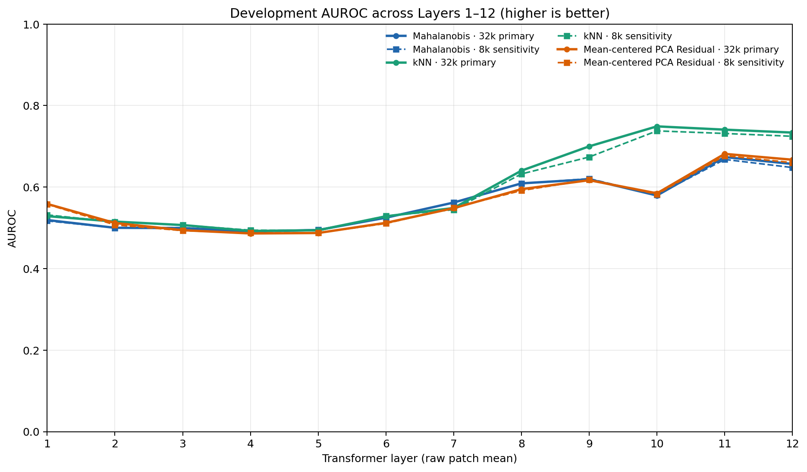

# Document OOD Gate for a Frozen DiT Classifier

## Abstract

Modern document classifiers perform well on familiar benchmarks but can still be highly
confident on unsupported documents. This project adds a post-hoc Gate in front of a frozen
16-class DiT classifier: supported documents should pass, while documents outside the supported
classes should be rejected. DiT is never retrained.

The study first reproduces the published MSP and Energy baselines, then compares output-level
confidence scores with representation-level methods such as kNN, Mahalanobis, and ViM under one
duplicate-aware, development-only protocol. A fixed follow-up study tests how final-layer
readout and Transformer depth change those representation-level signals, then evaluates the
entire pre-specified grid once on the held-out sealed test.

## Problem definition

| Set | Meaning | Desired Gate action |
|---|---|---|
| **T** | Familiar RVL-CDIP documents | Pass; used only as a false-rejection guardrail |
| **N** | Shifted documents that still belong to one of the 16 supported classes | Pass |
| **O** | Documents outside all 16 supported classes | Reject |

The Gate decides only whether an input should enter the downstream classifier. Whether DiT then
predicts the correct one of the 16 classes is a separate downstream task.

## Experimental design

| Item | Frozen setting |
|---|---|
| Classifier | [`microsoft/dit-base-finetuned-rvlcdip`](https://huggingface.co/microsoft/dit-base-finetuned-rvlcdip), revision `23f8b03d...`, float32 inference |
| N/O release | 1,002 N + 3,415 O target rows |
| Independent image rerun | 1,002 N + 3,310 O = 4,312 available/recovered images |
| Development comparison | 306 N + 974 O after removing one exact-pixel label-conflict group |
| Sealed test | 694 N + 2,324 O = 3,018 rows; opened and scored once after protocol freeze |
| RVL reference banks | Nested 8k / 32k / 80k, balanced over 16 classes |
| Threshold validation | Independent 8k RVL pages, 99% acceptance per score |
| T guardrail | Independent balanced 10k RVL pages, report-only |
| Primary metrics | AUROC ↑, FPR95 ↓, T false-rejection rate ↓ |
| Uncertainty | 2,000 stratified bootstrap resamples; seed `20260812` |

Execution order:

1. **Reproduction gate:** reproduce the paper's full-set MSP and Energy results before any new
   method is evaluated.
2. **Data audit:** detect byte-identical, pixel-identical, and confirmed near-duplicate images;
   keep each confirmed group within one split.
3. **Frozen split:** use approximately 30% for development and leave 70% sealed.
4. **Single signals:** compare five output scores, feature norm, kNN, and Mahalanobis.
5. **Supplementary panel:** evaluate fixed GEN, Relative Mahalanobis, ViM, and ReAct settings.
6. **Representation layer scan:** after two hard reproduction gates, compare final-layer raw
   patch mean, `h_doc`, and CLS, then report complete Layer 1–12 raw-mean curves.
7. **Final frozen evaluation:** decompose normalization and Residual dimension on development,
   freeze five replication predictions, then evaluate the complete 32k D1/D2 panel once on the
   3,018-row sealed test.

Exact parameter choices and leakage controls are recorded in
[`configs/protocol.md`](configs/protocol.md) and
[`configs/supplementary_protocol.md`](configs/supplementary_protocol.md). The frozen layer study
is recorded in [`configs/layer_scan_protocol.md`](configs/layer_scan_protocol.md). The final
boundary is recorded in [`configs/sealed_test_protocol.md`](configs/sealed_test_protocol.md),
with predictions frozen in [`configs/sealed_test_predictions.md`](configs/sealed_test_predictions.md).

## Latest results

### Published-baseline reproduction

| Scope | MSP AUROC / FPR95 | Energy AUROC / FPR95 |
|---|---:|---:|
| Published target, 4,417 rows | 0.7280 / 0.8470 | 0.7530 / 0.8430 |
| Independent rerun, 4,312 images | 0.7286 / 0.8465 | 0.7533 / 0.8444 |

**Reproduction gate: passed.** The remaining 105 O source images are unavailable in the live
author release. Author-provided logits are used only in a separately marked 4,417-row
output-score sensitivity result, never in representation-based experiments.

### Selected development results

| Signal | AUROC ↑ | FPR95 ↓ | T false rejection ↓ |
|---|---:|---:|---:|
| Energy | 0.7282 | 0.8614 | 1.13% |
| kNN, 80k reference | 0.7433 | 0.8511 | 0.89% |
| Mahalanobis, 32k reference | 0.7447 | 0.8162 | 0.89% |
| Mahalanobis, 80k reference | **0.7463** | 0.8306 | 0.92% |
| ViM, 32k reference | 0.7451 | **0.7988** | 1.00% |

Representation-based scores have slightly better development point estimates than the output
confidence baselines. However, the best observed FPR95 is still 0.7988: when 95% of N is
accepted, approximately 79.88% of O is also accepted. The current methods therefore do not yet
form a deployable Gate, and overlapping confidence intervals prevent a final winner claim.

### Frozen representation layer scan

Both execution gates passed: on the first float32 batch (`n=32`), Layer-12 raw patch mean
reconstructed `h_doc` with maximum absolute error `0 < 1e-5`, and the new Mahalanobis-8k run
reproduced AUROC `0.7416589` against target `0.7416556`. Exactly 32,000 reference and 1,280
development images were extracted once; the sealed test was not loaded or scored.

| Development observation | 32k AUROC ↑ | 32k FPR95 ↓ |
|---|---:|---:|
| L12 raw mean + Mahalanobis | 0.6567 | 0.9579 |
| `h_doc` + Mahalanobis | 0.7447 | 0.8162 |
| L12 CLS + Mahalanobis | 0.6633 | 0.8943 |
| Layer 10 raw mean + kNN | **0.7489** | 0.9425 |
| ViM-origin Residual-only | 0.7424 | 0.8080 |
| Full ViM | 0.7451 | **0.7988** |

The complete curves, confidence intervals, 8k sensitivity results, variance diagnostics, and
Residual definitions are in [`results/layer_scan/`](results/layer_scan/). Layer-specific values
are development observations and are not confirmed on held-out data.



See [`results/`](results/) for the complete tables, confidence intervals, paired comparisons,
duplicate audit, provenance, and machine-readable outputs.

### Final sealed replication

The final protocol reused the existing 32k reference cache and opened exactly 694 N + 2,324 O
sealed images once. Each image received one frozen DiT forward pass; no reference image was
re-extracted, and no method, layer, D, k, readout, or normalization was added after access.

| Frozen sealed result | AUROC ↑ | FPR95 ↓ |
|---|---:|---:|
| MSP | 0.7372 | 0.8468 |
| Energy | **0.7650** | 0.8369 |
| `h_doc` Mahalanobis-32k | 0.7474 | 0.8546 |
| `h_doc` kNN-32k (`k=10`) | 0.7405 | 0.8795 |
| ViM-origin Residual-only | 0.7433 | 0.8808 |
| ViM | 0.7473 | 0.8731 |
| Layer 11 LN-pooler Mahalanobis-32k | 0.7560 | 0.8490 |

All five pre-specified replication predictions were supported. Energy had the highest sealed
AUROC across the frozen D1+D2 set, while Layer 9 LN-pooler Mahalanobis had the lowest FPR95
(0.8171) but substantially lower AUROC (0.6607). This confirms that ranking quality and the
95%-N operating point select different configurations. Complete tables, confidence intervals,
prediction checks, and development-versus-sealed curves are in
[`results/sealed_test/`](results/sealed_test/).

The immutable local freeze commit `451fbdb4e902e75843e8e4ef5a31745cc95f1875` was created before
the first sealed image was accessed. Protocol deviation: command-line GitHub credentials were
unavailable, so it was not published before access. During final sync, its byte-identical tree
(`7d12bfd0dd46c5055ec2428bf93094b6188bb157`) was published as remote commit
`d0d058bdb7abd3ff719a0553aca58580823bb714`; the commit SHA differs because the GitHub API
generated new commit metadata. No scores existed when the implementation-only sealed-label
serialization repair was made, and no experimental setting changed.


## Repository structure

```text
.
├── README.md          # Background, design, headline results, and reproduction entry point
├── configs/           # Frozen YAML settings and executable experimental protocols
├── results/           # Complete human-readable and machine-readable experiment outputs
├── src/               # Reusable Python implementation and command-line pipeline
├── tests/             # Metric, data-isolation, and pipeline regression tests
├── pyproject.toml     # Exact Python package and dependency specification
└── .gitignore         # Keeps raw data, features, model weights, and credentials out of Git
```

## Reproduction

### 1. Environment

Python 3.12 is required. From the repository root:

```bash
python -m venv .venv
python -m pip install --upgrade pip
python -m pip install -e ".[dev]"
python -m pytest
```

The dependency versions, including PyTorch, Transformers, scikit-learn, Pillow, and pytest, are
pinned in [`pyproject.toml`](pyproject.toml).

### 2. Data

Download RVL-CDIP and the authors' RVL-CDIP-N/O release from the links in the References section.
Raw images are not redistributed here because of size and source-distribution constraints. All
commands accept explicit input paths; no personal path is hard-coded in the source.

### 3. Pipeline

The installed `doc-ood` command exposes every experimental stage:

```bash
doc-ood --help
doc-ood <stage> --help
```

| Stage | CLI command |
|---|---|
| Extract frozen DiT N/O logits and features | `extract-ood` |
| Reproduce MSP and Energy | `reproduce` / `reproduce-hybrid` |
| Audit and confirm duplicates | `audit-duplicates` / `finalize-duplicate-audit` |
| Create the grouped 30/70 split | `split-research` |
| Sample and extract RVL references | `sample-rvl` / `extract-rvl-sample` / `extract-rvl-features` |
| Evaluate the main single-signal panel | `evaluate-development` / `evaluate-reference-signals` |
| Evaluate the fixed supplementary panel | `extract-development-ood` / `evaluate-supplementary-baselines` |
| Run the G1/G2-gated representation study | `run-layer-scan` |
| Run final development A+B | `run-final-development` |
| Run the one-time frozen sealed evaluation | `run-final-sealed` |

Use [`configs/experiment.yaml`](configs/experiment.yaml) and
[`configs/supplementary_baselines.yaml`](configs/supplementary_baselines.yaml) for the original
frozen values, and [`configs/layer_scan.yaml`](configs/layer_scan.yaml) for the layer study. Each
command validates counts and refuses incompatible inputs. The layer command accepts only the
physically isolated development manifest, matches the 8k bank by frozen image IDs, and records
zero sealed rows loaded/scored.

## Current limits

- New layer representations did not re-extract the independent validation/T images; existing
  `h_doc` T-guardrail results remain unchanged and this round reports development AUROC/FPR95.
- The final sealed round evaluated only the pre-specified D1+D2 grid; it did not run 8k
  sensitivity, CLS, Residual-D sensitivity, new methods, or post-test redesign.
- A full shortcut audit was not performed. The development/sealed split preserves source
  composition, reducing source-distribution mismatch across splits, but this does not rule out
  within-task acquisition, rendering, or source-related shortcuts. In particular, 395 recovered
  O pages are calibrated rerenders rather than byte-identical original TIFFs.
- No evaluated configuration is a deployable Gate: even the lowest sealed FPR95 is 0.8171.

## References

- [Harley et al. — RVL-CDIP (ICDAR 2015)](https://adamharley.com/icdar15/harley_convnet_icdar15.pdf)
- [Li et al. — DiT: Self-Supervised Pre-Training for Document Image Transformer](https://github.com/microsoft/unilm/tree/master/dit)
- [Larson et al. — Evaluating Out-of-Distribution Performance on Document Image Classifiers](https://proceedings.neurips.cc/paper_files/paper/2022/hash/4c0986bd04d747745beba3752bdf4d9d-Abstract-Datasets_and_Benchmarks.html)
- [Larson et al. — RVL-CDIP-N/O data and released logits](https://github.com/gxlarson/RVL-CDIP-OOD)
- [Hendrycks & Gimpel — MSP baseline](https://arxiv.org/abs/1610.02136)
- [Liu et al. — Energy-based OOD Detection](https://proceedings.neurips.cc/paper/2020/hash/f5496252609c43eb8a3d147ab9b9c006-Abstract.html)
- [Lee et al. — Mahalanobis OOD Detection](https://proceedings.neurips.cc/paper/2018/hash/abdeb6f575ac5c6676b747bca8d09cc2-Abstract.html)
- [Wang et al. — ViM](https://github.com/haoqiwang/vim)
- [Ren et al. — Relative Mahalanobis](https://arxiv.org/abs/2106.09022)
- [Sun et al. — ReAct](https://proceedings.neurips.cc/paper_files/paper/2021/hash/01894d6f048493d2cacde3c579c315a3-Abstract.html)
- [Liu et al. — GEN implementation](https://github.com/XixiLiu95/GEN)
